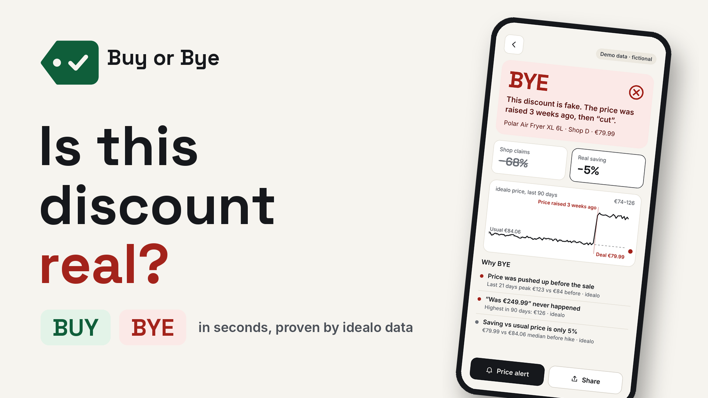

**Demo video:**

https://github.com/user-attachments/assets/f665af60-bb86-4c2e-82c1-a497af08e85c

Backup copy: [docs/assets/demo.mp4](docs/assets/demo.mp4)

# Buy or Bye

## The Problem

Fake discounts are everywhere in e-commerce. Shops show high "was" prices to make deals look better than they are. But those "was" prices often never existed. The deal is fake. German law requires real "was" prices ([PAngV § 11](https://www.gesetze-im-internet.de/pangv/__11.html)), but enforcement is patchy. As a shopper, how do you know if a deal is real?

## What it does, and for whom

<table>
<tr>
<td>

**For shoppers (B2C):**

A browser extension and mobile web app. You paste a deal, and it scores the deal: 
- 🟢 BUY: a deal you should consider
- 🔴 BYE: not really a deal 
- ⚪ WAIT: a real discount but not the best price yet
- ⚠ NOT ENOUGH DATA: unknown product or thin history

Deal scores are judged against 90 days of price history from idealo. Verdicts show the numbers: current price, % off, how often it's been this low.

</td>
<td>

**For retailers and brands (B2B):**

A "Fair Price Check" service to audit your own prices against the PAngV rules and catch non-compliant discounts before they ship. Heads off legal risk (fines up to €250,000) and PR blowback.

Add-on: Market Watch to police competitors' prices and report PAngV breaches to regulators.

Delivered as an API, a GitHub app, a Shopify/Shopware plugin, and a manual web tool. Runs checks in CI, when scheduling a campaign, after price imports, or ad hoc.

</td>
</tr>
</table>

## How idealo data drives the result

<table><tr><td>

**Tool**|**What we use it for**
:-----|:-----
`search_products` | Find the idealo product by an ID, URL, or shopping intent 
`get_product_price_history` | Judge deal quality: 90-day price low, discount %, markdown frequency
`get_product_offers` | 3-way price validation: deal vs. idealo price vs. other shops

</td><td>

The verdict rules then compare deal attributes against the thresholds:

**Attribute** | **Source** | **BUY if...**
:-----|:-----|:-----
Deal price (exact match) | `offersAggregation.offers[0].price` | Lower than 80% of last 22-60 days
Deal price % vs 90-day min | `priceHistory.{min,max}` + deal input | At least 5% lower
Times at this price or lower | `priceHistory.series[].price` + deal input | In lowest 20% of 90 days
"Was" price (if claimed) | Retailer + `statistics.avg30d` | Under 5% off 30-day average
Retailer price vs market | Retailer + `offersAggregation.offers[<5]` | Beats next 5 shops' price

All rules must match for BUY. Any mismatch is BYE unless the price ties the 90-day low, then WAIT. The 90-day window rolls: always the latest data.

</td></tr></table>

## What idealo didn't expect 

- **Real-time deal judgment:** We're the "PAngV police" — checking deal claims while the sale is live
- **Protecting retailers:** B2B self-audit and screening catches violations before they ship
- **Policing competitors:** Market Watch hunts breaches at scale as a brand-safety lever
- **Mobile deal-check:** Snap a deal, see a ruling. No more "buy first, check prices later"
- **Conversation:** Live chat deal analysis by texting a photo. Knows your favorite products

## Run it yourself

**Prerequisites:**
- [Claude Desktop](https://www.anthropic.com/claude-for-desktops) running in any local folder 
- Local ports 6274 (Claude OAuth) and 6783 open
- Sign up for [idealo MCP access](https://mcp.idealo.com/hackathon)

**Commands:**
- `make dev`: launch the dev server at http://localhost:8000
  - `PRICE_SOURCE=idealo`: use live idealo MCP data
  - Default: use demo fixtures (`tests/fixtures/idealo`)
- `make demo`: run a smoke test of known products
- `make check`: lint + type-check + 777 tests
- `make idealo-login`: get an OAuth token and probe idealo MCP
- `make live`: start a live idealo-powered server on your public URL (needs idealo OAuth)

**Live API playground:**

Test with [cURL on the /api/v1/product-url/check endpoint](docs/bob-url-001.md), `IDEALO_DAILY_LIMIT=500`. The UI uses that same endpoint.

**Configuration:**
- `IDEALO_MCP_URL`: override the MCP server
- `IDEALO_OAUTH_FILE`: idealo OAuth token storage (default ~/.buyorbye/idealo_oauth.json)

## Business case

**Target markets:** 
- Self-service: Shopify/Shopware plugin, Stripe billing, marketed via Händlerbund
- Enterprise: SaaS with price-history scanning, custom source control hooks, and Market Watch

**Revenue model:** 
- B2C free with a "Buy or Bye Plus" upgrade for mobile deal scanning, deal alerts, and multi-factor judgment
- B2B SaaS tiers: €49 self-serve / €299 SMB / custom enterprise
  - Assumptions: 300K online shops in Germany, 10% addressable, 5% B2B conversion rate, €69 ARPU

**Why idealo:**
- Most trusted source for price history
- Broad SKU coverage
- MCP is a game-changer: brings price transparency to the point of decision

**Competition:**
- Fake-deal detection: none
- Price history: EanFindR, Keepa, CamelCamelCamel
- Market visibility: Apify/ScrapingAnt crawls

**Go-to-market plan:**
- Launch freemium B2C to establish credibility as the deal police
- Content/PR blitz on recent PAngV enforcement, worst breaches
- Thought leadership: cost of noncompliance, how to be PAngV-compliant
- Inside sales to larger retailers
- Expand plugins and integrations
- Sell enterprise (custom connectors, per-seat pricing, volume discounts)

## Status

### Architecture

[Architecture Diagrams](docs/arch)

### Implementation plan

[Implementation plan](docs/implementation_plan.md)

### Guardrails

[Guardrails](docs/guardrails.md)

### Evaluation

[Evaluation](docs/evaluation.md)

## Team

- Arina [arina@email.com](mailto:arina@email.com): Business strategy, enterprise sales
- Chadha [chadha@email.com](mailto:chadha@email.com): Architecture, backend, API, DevOps
- Claude [claude@anthropic.com](mailto:claude@anthropic.com): Engineering, ML, data pipeline 
- Eschwar [eschwar@email.com](mailto:eschwar@email.com): Frontend, browser extension, mobile
- Mobina [mobina@email.com](mailto:mobina@email.com): Product management, integrations

🙋‍♂️ We're hiring! Reach out to [hello@buyorbye.com](mailto:hello@buyorbye.com) with a link to your best work.

---

_This project uses fictional data and company names for demonstration purposes only. The verdicts and scenarios presented here are not real._
