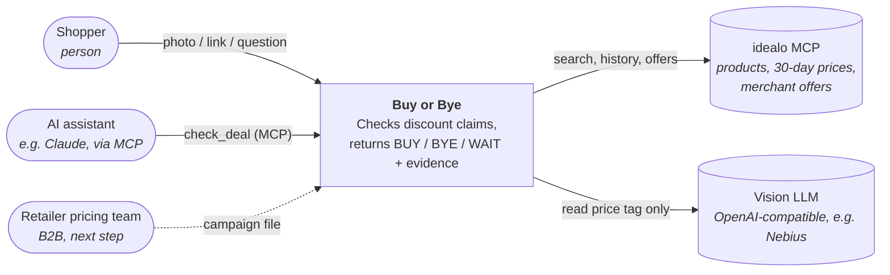
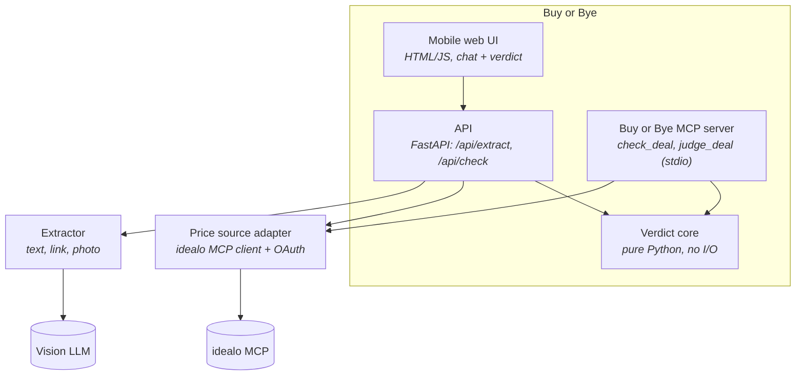
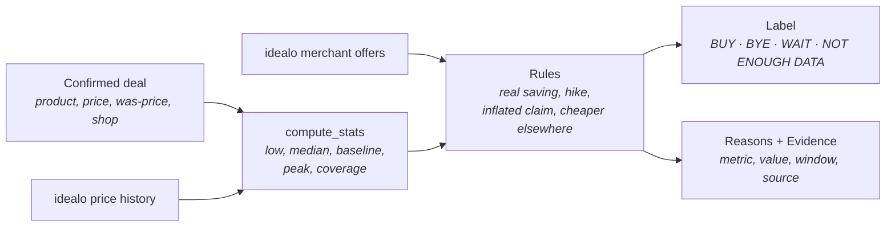

# Buy or Bye

**Is this discount real? A trust layer for shopping, powered by idealo data.**

Buy or Bye checks any deal (a photo of a price tag, a link, or a chat message) against idealo's price history and live merchant offers, and answers **BUY**, **BYE** or **WAIT**, with the evidence behind every reason. The verdict is calculated by deterministic code, never guessed by an LLM.

Built at **AI Agents Berlin, "From Research to Commerce" (27 Nov 2026)** for the idealo challenge *"Build Something We Didn't Expect"*.


**Demo video:**

https://github.com/user-attachments/assets/f665af60-bb86-4c2e-82c1-a497af08e85c

Backup copy: [docs/assets/demo.mp4](docs/assets/demo.mp4)

---

## 1. The problem

- On Black Friday, many "−70%" deals are not real: the price is raised weeks before the sale and then "cut", or the "was" price never existed.
- German law already forbids this. **§ 11 PAngV** requires every advertised reduction to be calculated from the lowest price of the last 30 days (confirmed by the ECJ, *Aldi Süd*, C-330/23). But shoppers can't check it in the moment, least of all in a physical store.
- People increasingly ask AI assistants "is this a good deal?". A general chatbot has no price history, so it guesses.

## 2. What it does, and for whom

| Who | What they get |
|---|---|
| **Shoppers (B2C)** | Snap, paste or ask → BUY / BYE / WAIT in seconds, with the idealo evidence. The shopper decides and buys on the shop's site. |
| **AI assistants** | Buy or Bye is an **MCP server**: any assistant can ask "is this discount real?" and get a verdict backed by idealo data. |
| **Shops (B2B, next step)** | *Fair Price Check*: test a campaign against the 30-day rule **before** launch, to avoid warnings and fines. |

## 3. How idealo data drives the result

| idealo MCP tool | Signal | Used for |
|---|---|---|
| `search_products` | **Product** | Match the deal to the right idealo product. A weak match returns *no data*, never a wrong product. |
| `get_product_price_history` | **Price** (30 days, daily) | Typical price, recent low, real saving, pre-sale price hike, whether the claimed "was" price ever happened |
| `get_product_offers` | **Merchants and availability** | Is another shop cheaper right now? |

**Verdict rules** (`app/verdict.py`, all thresholds in one place):

| Verdict | When |
|---|---|
| **BYE** | Any red flag: claimed saving far above the real one · "was" price never seen · price pushed up before the sale · ≥ 5% cheaper at another merchant |
| **BUY** | Real saving ≥ 10% **and** at or near the lowest recent price |
| **WAIT** | Fair, but it has been cheaper. Offer a price alert. |
| **NOT ENOUGH DATA** | Fewer than 10 days of history, or no confident product match. We never guess. |

**What idealo didn't expect:** idealo answers *"where is it cheapest?"*. We use its data to answer *"is this discount claim true?"*: in a store from a photo, inside any AI chat through an MCP built on top of idealo's MCP, and, next, for shops before they launch a campaign.

## 4. Architecture (C4)

### Level 1: System context



### Level 2: Containers



### Level 3: Components of the verdict core



**Design decisions** (see `docs/adr/`):
1. **Code decides, the LLM only reads.** The vision model turns a photo into fields; the shopper confirms them; deterministic rules set the label. Same input, same answer.
2. **No data, no verdict.** Missing or thin data is a gap, never a negative.
3. **Evidence on every reason:** metric, value, time window and source (idealo / user / demo).
4. **One adapter talks to idealo** (`app/sources.py`), so the rules are testable without the network.
5. **Untrusted input.** Photos, links and OCR text are data, never instructions.

## 5. Run it

```bash
pip install -e ".[dev,idealo]"
make dev                                 # http://localhost:8000 on labelled demo data
make check                               # ruff + mypy + pytest (777 tests)
make demo                                # 5 demo deals with expected labels

make idealo-login Q="sony wh-1000xm5"    # one-time idealo sign-in (OAuth)
make live                                # the app on live idealo data
```
In live mode a pasted product link goes through `POST /api/v1/product-url/check`: product identity with its sources, the idealo match, price provenance ("last seen by idealo … ago"), every current offer, and the verdict. See [`docs/bob-url-001.md`](docs/bob-url-001.md). idealo calls are capped per day (`IDEALO_DAILY_LIMIT`, max 500). Mapping and limits: [`docs/idealo-mcp.md`](docs/idealo-mcp.md).

**In Claude Desktop:** add to `claude_desktop_config.json`:
```json
{ "mcpServers": { "buy-or-bye": {
  "command": "/full/path/to/python", "args": ["-m", "app.mcp_server"],
  "env": { "PRICE_SOURCE": "idealo" } } } }
```

**Stack:** Python 3.12 · FastAPI · Pydantic · MCP SDK (client + server) · OpenAI-compatible vision model · vanilla HTML/JS · pytest, ruff, mypy · Claude Code harness (`CLAUDE.md`, hooks, skills, reviewer subagent).

## 6. Business

**Market.** Shoppers already ask AI about purchases: in one German survey (early 2026), 70% had used AI tools for product and price research. Trust is the bottleneck: only a small minority would let an AI complete a purchase on its own. Buy or Bye builds that trust without taking control from the shopper.

**Revenue model.**

| | B2C app | B2B Fair Price Check |
|---|---|---|
| Who pays | Free for shoppers | Shops and brands |
| Model | Neutral affiliate (never changes a verdict) · later a small Plus plan for alerts | SaaS subscription, tiered by product count, plus API usage |
| Role | Attention, trust, data on where fake discounts happen | **Main revenue** |

**Why idealo.** idealo already has the price history and the merchant network. Buy or Bye turns that data into a *decision* for shoppers, a *trust signal* for listings ("fair price verified"), and a *compliance service* for the shops idealo already works with.

**Competition.** Price trackers and idealo's own price chart show data, but don't judge a shop's discount claim. In Czechia, *Hlídač shopů* has tracked fake Black Friday discounts for years, which proves the need. Our differences: Germany, idealo data, in-store photo, AI-assistant access, and prevention for shops (B2B).

**Go-to-market.** Black Week for B2C attention → B2B pilots with 5–10 shops through idealo's partner network and shop-system app stores (Shopware, Shopify) → sell in September–October, before the next Black Week.

## 7. Status and roadmap

**Working today:** web app (text, link, photo → confirm → verdict), live link check with identity and price provenance, 777 automated tests, idealo adapter mapped from idealo's published tool reference, Buy or Bye MCP server (tested over stdio).
**Honest limits:** idealo history covers 30 days; demo screens use fictional, labelled products; B2B is designed, not built.

**Next:** B2B campaign check (CSV → OK / RISK + corrected reference price) · price alerts · flyer scan (many deals from one photo) · move into the production architecture in [`ARCHITECTURE.md`](ARCHITECTURE.md) following the milestones in [`IMPLEMENTATION_PLAN.md`](IMPLEMENTATION_PLAN.md) (guardrails: [`GUARDRAILS.md`](GUARDRAILS.md), evaluation: [`EVALUATION.md`](EVALUATION.md)).

## 8. Team

Buy or Bye team: Mobina, Arina, Chadha, Eschwar.

*Not legal advice. Verdicts describe price history; they do not accuse any shop.*
